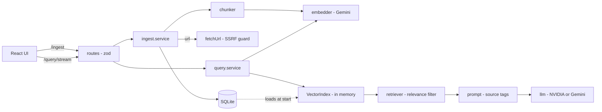

# AI Knowledge Inbox

Save notes and links, then ask questions. Answers are built only from what you saved, with `[n]` citations pointing at the sources.

## Quick start

Needs Node 24 and a Gemini API key.

```bash
npm run setup          # installs everything, creates server/.env from .env.example
# put GEMINI_API_KEY in server/.env
npm run dev            # API on :4000, UI on :5173
```

Optional: `cd server && npm run seed` loads sample notes and URLs; `npm test` runs the server tests; `npm run eval` runs the 13-question quality check.
`GEMINI_API_KEY` alone is enough. `NVIDIA_API_KEY` is optional and makes answers faster (see "Models").

## Architecture



- `routes/` are thin: validate, call a service, respond. `services/` orchestrate and never touch `req`/`res`.
- `db/` is the only place with SQL. `lib/llm.ts` and `rag/embedder.ts` are the only places that call models.
- Errors always look like `{ error: { code, message, requestId } }`. Logs are structured pino events with a request id.

## Features

- Save notes and URLs; edit and delete notes; pin one of your own chat messages to the inbox
- Streaming answers with `[n]` citations, dated sources, and up to 3 follow-up suggestions (only ones the notes can answer)
- Chat tabs with memory; follow-up questions are rewritten so they stand alone ("and where is the hotel?")
- "Note edited since" warning on old answers, source preview panel
- Details panel (`DEBUG=true`): rewritten question, every candidate with its score and why it was kept, timings

## Design decisions

- **Chunking:** URLs split by `h1`-`h3` sections (sections never mix); each chunk starts with its heading. Inside a section, sentences are packed to about 2000 characters (~500 tokens) with the last 2 sentences repeated at the next chunk. Pieces under 200 characters merge into their neighbour. Short notes stay one chunk. The embedded text is `"<title> - <chunk>"`; only the chunk is stored and shown.
- **Vector index:** all vectors live in one normalized `Float32Array` loaded at startup, so search is a dot product. Exact (no approximation), kept in sync on ingest, edit, delete and reindex. Measured: 0.2 ms for 78 chunks, 19 ms for 10,000 chunks (3072 dims, synthetic).
- **Models:** embeddings are Gemini `gemini-embedding-001` (3072 dims). Answers use NVIDIA `poolside/laguna-xs-2.1` when `NVIDIA_API_KEY` is set, otherwise Gemini `gemini-3.8-flash`. If the NVIDIA model is retired (404/410) the call silently retries once on Gemini.
- **Relevance:** keep a chunk if its score is within 0.12 of the best one, or at least 0.6 on its own, so a second relevant note is not hidden. Nothing relevant: the model is told to say it couldn't find it.
- **Citations:** sources are numbered in the prompt; the answer's `[n]` markers decide which sources are returned. If nothing is cited, the closest source is shown.
- **Newest fact wins:** every source carries its saved date, and the prompt says to trust the most recent one and mention the change.

### Answer-model speed

Real prompt (system prompt + 3 seed chunks), streaming, 5 runs each, 2026-11-18. Details in [`server/eval/latency.md`](server/eval/latency.md).

| Model | First token min / median / max (ms) | Total median (ms) |
|-------|-------------------------------------|-------------------|
| NVIDIA `poolside/laguna-xs-2.1` (default with NVIDIA key) | 306 / 323 / 582 | 908 |
| Gemini `gemini-3.1-flash-lite` | 871 / 1057 / 1189 | 1175 |
| Gemini `gemini-3.5-flash-lite` | 700 / 1548 / 2747 | 1747 |
| Gemini `gemini-3.8-flash` (zero-setup default, fallback) | no answer: timeouts and a 503 that day | n/a |

NVIDIA is about 3x faster to the first word, so it stays the default when a key is present. The Gemini fast model was overloaded during the run, so its speed is unknown.

## Security

- **SSRF:** before fetching, the hostname is resolved and rejected if any address is loopback, private, link-local or `localhost`; only `http`/`https`; redirects are followed manually (max 3) and each target is re-checked. Blocked URLs return `422 URL_NOT_ALLOWED`.
- **Prompt injection:** saved text is untrusted. Each chunk is wrapped in `<source ...>` tags (any `<source` strings inside are stripped), and the system prompt says sources are data, never instructions. Instruction-like text ("ignore previous instructions", ...) is flagged at ingest and shown with a warning badge; it is not blocked. The answer model has no tools, and AI answers are never saved as knowledge.
- **UI:** everything is rendered as text; no `dangerouslySetInnerHTML`; external links use `rel="noopener noreferrer"`.
- Keys live in `server/.env` (git-ignored). `.env.example` lists every setting.

## Debugging and eval

- `DEBUG=true` adds a `debug` object to answers (rewritten question, candidates with scores, timings) and a "Show details" toggle in the UI.
- `npm run eval` (in `server/`) asks 13 questions (6 single, 2 follow-up chats, 3 not in the notes) and checks keywords, expected source and the not-found phrase. Current score: **13 / 13**. Baseline and notes: [`server/eval/baseline.md`](server/eval/baseline.md).
- `npm test`: 53 server tests (SSRF, injection, relevance, fallback, edit/delete, pin, chunking, vector index, reindex).

## Known limits

- **DNS rebinding:** the SSRF check resolves the name, then the fetch resolves it again; a hostile DNS server could answer differently the second time. Fix: connect to the checked IP.
- **Existing databases need `npm run reindex` once** (in `server/`) after upgrading, so old chunks are replaced by the new chunking. Old URL items also lack heading lines until re-added.
- Small answer models write weaker follow-up suggestions than large ones, and sometimes skip them.
- Top-k retrieval can't answer "list all X" questions over many records.
- One user, one process: SQLite single writer, synchronous ingest, no auth, no rate limiting.

## Future work

- Phase D ideas: review popup that proposes lasting facts when a chat closes (D1), email drafts that need confirmation (D2), local/both embedding modes (D3), answer cache with optional Redis (D4)
- Smaller embedding sizes (1536/768 dims), LLM reranking
- Hybrid keyword + vector search, query embedding cache, evaluation engine with Recall@k/MRR (planned in [`doc/DEVELOPMENT.md`](doc/DEVELOPMENT.md))
- sqlite-vec, then pgvector (HNSW) or Qdrant for large data; job queue for ingestion
- Structured fields + SQL filters for list/aggregate questions
- Classifier-based injection detection; server-side action approval with audit log; auth and multi-user isolation

The full plan, rules and change log are in [`doc/DEVELOPMENT.md`](doc/DEVELOPMENT.md).
